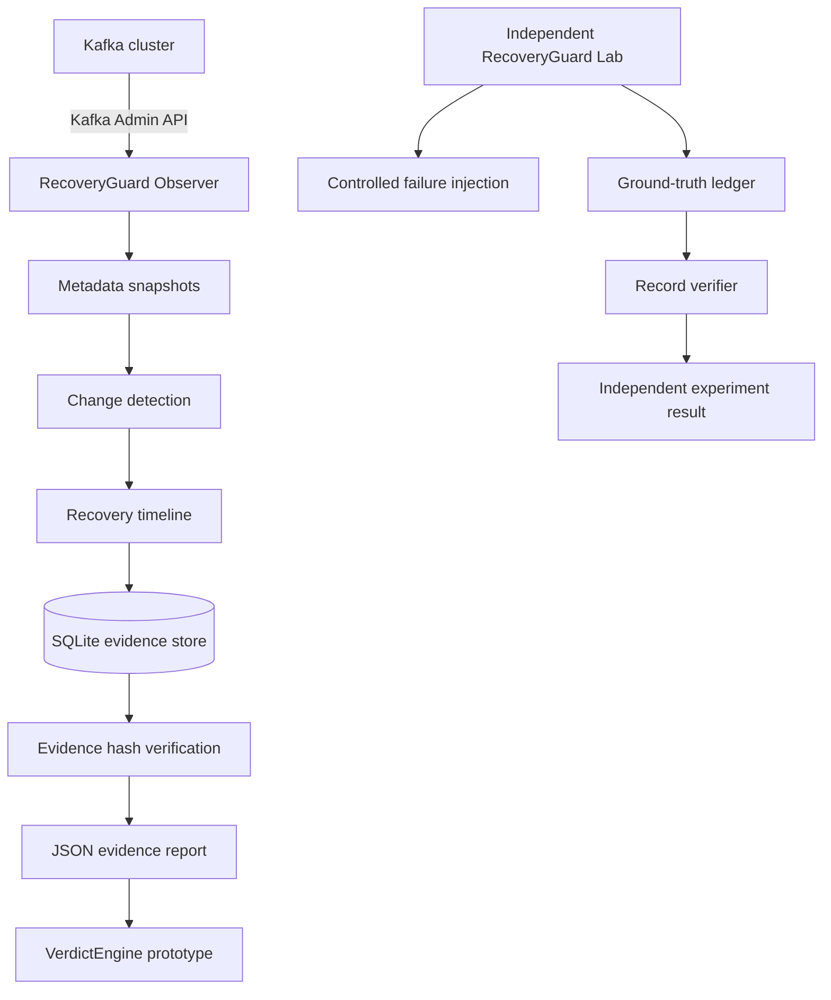

# RecoveryGuard

**Independent Kafka recovery evidence and validation**

RecoveryGuard is a read-only system for collecting Kafka metadata around recovery events, preserving observations, reconstructing observed changes, and evaluating evidence against explicit validation rules.

Kafka can restore service after a failure. Service restoration alone does not prove that acknowledged writes were preserved. RecoveryGuard is designed to make the available evidence, validation scope, and remaining uncertainty explicit.

> **Development status:** Active engineering. The repository contains Kafka Admin API observation, bounded metadata capture, recovery change detection, timeline reconstruction, SQLite evidence persistence, evidence hash verification, and a deterministic VerdictEngine prototype. It is not a production-ready release. Three VerdictEngine decisions remain open.

## Capabilities implemented

- Collect cluster, topic, partition, leader, replica, ISR, and topic configuration metadata through Kafka Admin APIs.
- Compare metadata snapshots and detect broker membership, leader, and ISR changes.
- Reconstruct a deterministic timeline without claiming unobserved causality.
- Persist investigations, observations, and timeline entries in SQLite.
- Verify stored evidence hashes.
- Generate a JSON report from a bounded capture.
- Evaluate supplied check results through a pure Java VerdictEngine.

## Safety and evidence boundaries

- The Observer does not create Kafka consumers, join consumer groups, read records, commit offsets, or produce records.
- The Observer does not create or delete topics, alter configuration, change assignments, or trigger recovery.
- RecoveryGuard does not install broker plugins or require customer application changes for metadata collection.
- Kafka metadata cannot prove record integrity, acknowledged-write durability, or application correctness.
- Evidence hashes verify stored evidence against stored hashes. They do not prove source authenticity.
- Record-level claims require independent evidence, such as the Lab ground-truth ledger or a customer-approved application contract.

## System view



The Lab is a separate test system. The product does not import or depend on Lab code, packages, images, or build artifacts.

## Repository map

| Path | Responsibility |
|---|---|
| `src/main/java/com/recoveryguard/observer` | Kafka Admin API collection and command-line entry points |
| `src/main/java/com/recoveryguard/evidence` | Snapshots, change detection, and timeline reconstruction |
| `src/main/java/com/recoveryguard/persistence` | SQLite evidence storage and JSON serialization |
| `src/main/java/com/recoveryguard/engine` | Pure verdict decision model |
| `src/test` | Unit and integration tests |
| `docs/` | Architecture, operation, evidence, decision rules, and contribution standards |
| `.github/workflows/` | Continuous integration and Lab-backed Observer integration |

## Requirements

- JDK 17
- Maven 3.9 or later
- Network access to the Kafka bootstrap endpoint and all broker endpoints returned by Kafka metadata

## Build and test

Run from the repository root:

```bash
mvn --batch-mode --no-transfer-progress clean verify
```

## Run bounded evidence capture

```bash
mvn --batch-mode --no-transfer-progress exec:java \
  -Dexec.mainClass=com.recoveryguard.observer.RecoveryCaptureMain \
  '-Dexec.args=--bootstrap-server localhost:29092 --observations 20 --interval-ms 1000 --database ./data/recoveryguard.db --report ./reports/investigation.json'
```

See [Observer Operations](docs/observer.md) for command options, authentication properties, output, and limitations.

## Technical documentation

- [Product architecture](docs/architecture.md)
- [Observer operations and safety](docs/observer.md)
- [Recovery evidence and persistence](docs/recovery-evidence.md)
- [Verdict Engine decision table](docs/engine-decision-table.md)
- [Glossary](docs/glossary.md)
- [Engineering and contribution standard](docs/contributing.md)

## Related repository

[RecoveryGuard Lab](https://github.com/KrishCodesw/recoveryguard-lab) contains the isolated Kafka test environment, controlled failure procedures, workload, independent ground-truth ledger, and record verifier. It is not a product runtime dependency.

## Contribution workflow

1. Create a focused branch from `main`.
2. Add or update tests for changed behaviour.
3. Update affected contracts and documentation.
4. Run the relevant Maven checks.
5. Open a pull request with design notes, test evidence, and known limitations.
6. Wait for maintainer approval before merge.

Do not push directly to `main`.
