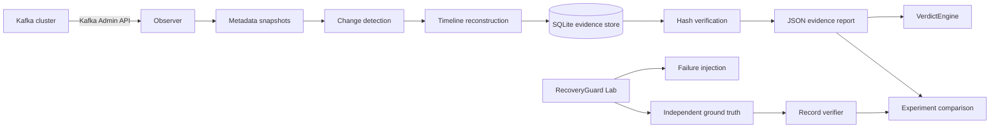

# RecoveryGuard Product Architecture

**Document type:** Product architecture  
**Status:** Current implementation and target direction are separated  
**Last reviewed:** 2026-11-28

## 1. Purpose

RecoveryGuard collects and validates evidence about Kafka recovery.

Kafka may restore partition availability after a broker failure. This does not prove that all acknowledged writes remain available or that an application preserved its business invariants.

RecoveryGuard provides an evidence-based assessment for a defined scope. It complements Kafka operations, monitoring, balancing tools, and incident runbooks. It does not replace them and does not execute recovery actions.

## 2. Architecture principles

1. **Read-only observation.** The Observer uses Kafka Admin APIs only.
2. **External evidence storage.** Evidence is stored outside the Kafka cluster under investigation.
3. **Evidence before verdict.** Every result must identify its checks and supporting evidence.
4. **No unsupported inference.** Metadata is not proof of record integrity or business correctness.
5. **Independent ground truth.** Lab verification does not use product verdict code as its oracle.
6. **Deterministic evaluation.** VerdictEngine is a pure function of explicit inputs.
7. **Visible uncertainty.** Missing, partial, stale, or unordered evidence remains visible.
8. **Repository separation.** Product code does not import or depend on Lab code.

## 3. System context

The Lab path is independent. It supports controlled tests and does not run as part of the product.

## 4. Current implementation

| Component | Responsibility |
|---|---|
| Observer command-line tools | Collect cluster, topic, partition, and configuration metadata |
| `KafkaMetadataSnapshotCollector` | Collect cluster and partition metadata through Kafka Admin APIs |
| `RecoveryChangeDetector` | Detect broker membership, leader, and ISR changes between snapshots |
| `RecoveryTimelineReconstructor` | Build a deterministic timeline from ordered snapshots |
| `SQLiteEvidenceStore` | Persist investigations, observations, and timeline entries |
| `EvidenceJsonCodec` | Serialize evidence as JSON |
| `RecoveryCaptureMain` | Run bounded capture, persistence, timeline reconstruction, hash checks, and report generation |
| `VerdictEngine` | Evaluate supplied check results without Kafka, storage, clock, or network access |

The current implementation is a local Java application with command-line entry points and SQLite persistence. It is not a distributed Site/Agent platform.

## 5. Current evidence flow

1. The operator supplies Kafka bootstrap endpoints and optional client properties.
2. The Observer creates a Kafka Admin client.
3. It collects a bounded sequence of metadata snapshots.
4. The change detector compares adjacent snapshots.
5. The timeline reconstructor records snapshots and detected changes.
6. SQLite stores observations and timeline entries.
7. The implementation verifies stored evidence hashes.
8. The capture command completes the investigation and emits a JSON report.

Snapshots use multiple Admin API requests. They are not atomic cluster-wide transactions. A transition can occur between polls and remain unobserved. The timeline records observed order; it does not infer unobserved intermediate states or causality.

## 6. Kafka API and safety boundary

Current Observer commands use Kafka Admin APIs to describe cluster metadata, list and describe topics and partitions, describe topic configuration, and collect metadata snapshots.

The Observer must not:

- create a Kafka Consumer;
- subscribe to or assign partitions to a consumer;
- poll topic records;
- join a consumer group;
- commit offsets;
- produce records;
- create or delete topics;
- alter topic or broker configuration;
- change partition assignments; or
- trigger leader election or recovery.

A bootstrap endpoint being reachable does not prove that all advertised broker endpoints are reachable. The deployment must permit access to the endpoints returned by Kafka metadata.

Every new Admin API operation requires a review of its purpose, Kafka permissions, request cost, timeout, and failure behaviour.

## 7. Evidence model

Current metadata evidence includes:

- Kafka cluster ID and observation timestamp;
- broker IDs returned by Kafka;
- topic and partition identity;
- partition leader IDs;
- assigned replica broker IDs; and
- ISR broker IDs.

Current detected signals are:

- `BROKER_UNAVAILABLE`;
- `BROKER_AVAILABLE`;
- `LEADER_CHANGED`; and
- `ISR_CHANGED`.

Broker membership in metadata is not a direct process-health check. The current product evidence does not contain Kafka record payloads or the independent application acknowledgement ledger. It cannot prove acknowledged-write preservation.

## 8. Persistence and integrity

The current persistence implementation uses SQLite:

| Table | Responsibility |
|---|---|
| `investigations` | Investigation identity, cluster identity, lifecycle, timestamps, and version data |
| `observations` | Metadata snapshots in collection order |
| `timeline_entries` | Reconstructed entries linked to source observations |

Evidence rows are append-only through database triggers. SHA-256 checks detect changes when the stored hash is not also changed. They do not prove source authenticity or protect against an actor who can rewrite both data and hashes.

The current implementation targets one application process per SQLite database file. It is not a distributed storage service.

## 9. Verdict evaluation

The repository contains a pure Java VerdictEngine prototype. Current enum values are:

- `RECOVERY_VALIDATED`
- `DATA_INTEGRITY_FAILURE`
- `INCONCLUSIVE`
- `VALIDATION_ERROR`

Three decision rules remain open. The engine fails fast when an unresolved rule affects the result. See [Verdict Engine Decision Table](engine-decision-table.md).

The current metadata capture command does not yet provide a complete recovery validation pipeline. The engine evaluates supplied check results; it does not independently collect or prove them.

## 10. Target architecture — not implemented

The longer-term product direction may include:

- a customer-side control and evidence service;
- a local Agent for Kafka connectivity and evidence collection;
- authenticated evidence transfer;
- a relational evidence catalog and object storage;
- scheduled collection and incident windows;
- customer-defined application evidence contracts;
- access control, audit records, retention controls, and deployment operations.

These are target capabilities. Do not describe them as current features until code, tests, operational procedures, and release criteria support them.

The first product release should remain a small, testable vertical slice. Do not split components into services without a demonstrated need.

## 11. Production-readiness requirements

Before production use, the product requires:

- tested TLS and SASL configuration;
- least-privilege Kafka permission documentation;
- secure secret handling;
- bounded requests, timeouts, and polling;
- explicit partial-collection behaviour;
- evidence encryption, retention, export, and deletion controls;
- audit controls;
- backup and restore procedures; and
- a tested Kafka distribution and broker-version compatibility matrix.

These are requirements, not claims that the current code already meets them.

## 12. Compatibility and change control

Kafka compatibility must be based on integration tests, not only on the Kafka client dependency version.

For each supported target, record the distribution, broker version, client version, authentication mode, enabled Admin API operations, tested topology, and test result.

Evidence schemas, verdict values, check semantics, and rule precedence are controlled product contracts. Change them through reviewed pull requests.
